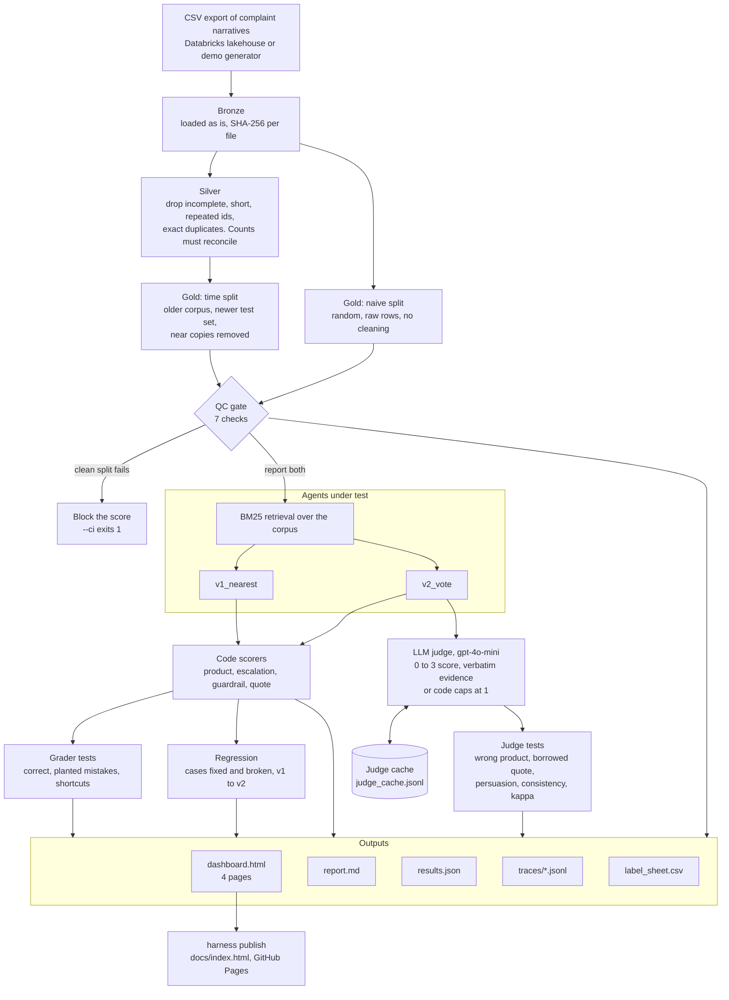

# Eval QC Harness

Checks whether an AI agent's evaluation score can be trusted, by testing the data under the score and the graders on top of it.

## Status

Prototype. The full pipeline (data layers, QC gate, two agent versions, code scorers, grader tests, LLM judge, regression report and dashboard) runs end to end and is covered by 12 tests. The judge tests use a fake client, so the test suite never calls an API.

- Runs so far use a generated test set of 1,550 synthetic complaints. The LLM judge has run live with gpt-4o-mini on that set.
- The first run on real CFPB complaint narratives, exported from my Databricks lakehouse, is pending.
- Live dashboard (synthetic test set until the real run): https://priyanka-0207.github.io/eval-qc-harness/

## Purpose

An eval score is only as good as two things under it: the dataset and the grader.

- If test cases, or near copies of them, are also in the data the agent searches, the score is inflated. The agent is being tested on answers it can look up.
- If the grader can be fooled by a planted mistake or a cheating answer, the score is wrong no matter how clean the data is.
- If an LLM judge does the grading, it needs the same scrutiny, because it can be lenient, inconsistent or swayed by confident wording.

Most teams check none of these before trusting a number. This harness checks all three and blocks the score when the data fails.

## Methods Used

- Medallion layering (bronze, silver, gold) with row-count reconciliation at every step
- Time-based split, so the retrieval corpus is always older than the test set
- Near-duplicate detection with 5-word shingles and Jaccard similarity
- BM25 retrieval, implemented from scratch
- Guardrail labels derived from CFPB issue labels and consumer tags
- Grader testing with correct answers, planted mistakes and shortcut (cheating) answers
- Case-level regression comparison between two agent versions
- LLM-as-a-judge on an anchored 0 to 3 scale, with code-enforced grounding of the judge's evidence
- Judge testing for leniency, persuasion and repeat-run consistency
- Cohen's kappa for judge vs label and scorer vs human agreement

## Technologies

Python 3 and pytest. The optional LLM judge calls the OpenAI API (gpt-4o-mini). Everything except the judge runs offline, and the dashboard is a single HTML file with no external scripts or fonts.

## Required Libraries

Standard library only: `argparse`, `collections`, `csv`, `datetime`, `hashlib`, `html`, `json`, `math`, `os`, `pathlib`, `random`, `re`, `sys`, `urllib`. The judge calls the OpenAI API over `urllib`, so no SDK is needed. `pytest` is the only install, for tests.

## Project Description

### The system under test

A complaint-routing agent reads a consumer complaint, retrieves similar past complaints, and returns three things:

| Output | Example |
|---|---|
| `product` | "Debt collection" |
| `escalate` | `true` when the complaint must go to a human |
| `quote` | A sentence copied word for word from the complaint that supports the decision |

Escalation is required when a complaint is tagged Servicemember or Older American, or when its CFPB issue label names fraud, a scam or identity theft. The agent sees only the complaint text and tags, never the issue label, so it has to infer fraud from the text.

Two versions are compared:

| Version | Product | Escalation | Quote |
|---|---|---|---|
| `v1_nearest` | Product of the single closest past complaint | Short fraud word list | First sentence |
| `v2_vote` | Score-weighted vote over the 9 closest complaints | Longer fraud phrase list ("not mine", "never opened") | Sentence that best matches the retrieved complaints |

The agent is deliberately simple. The point of the project is everything around it, and any agent that returns the same three fields can be dropped in.

### Two splits of the same data

| Split | How it is built | Why it exists |
|---|---|---|
| `time` (clean) | Corpus is older than the test set. Exact duplicates are removed in silver, and near copies of corpus complaints are removed from the test pool | The honest test |
| `naive` | Random split of raw bronze rows, with no dedupe and no time order | How many eval sets actually get built. The gap between the two splits measures leakage |

Both splits use 200 test cases, stratified by product.

### Data layers

| Layer | What happens |
|---|---|
| Bronze | The CSV export, loaded as is. Column names are matched against common variants, and each file gets a SHA-256 hash so a result can be traced to the exact input |
| Silver | Drops rows missing an id, product, narrative or date, narratives under 20 words, repeated complaint ids, and exact duplicate narratives after redaction marks and punctuation are removed. Each step records how many rows it dropped, and bronze minus every drop must equal silver |
| Gold | The `time` and `naive` splits, each written as a retrieval corpus and a test set |

### QC gate

The gate runs before any agent is scored. `python -m harness all --ci` exits with code 1 if the clean split fails, so it can block a pull request.

| Check | Fails when |
|---|---|
| Row counts reconcile | Bronze minus every drop does not equal silver |
| No duplicates in the test set | Any repeated id, or more than 5% duplicate narratives |
| No id leakage | Any test id is also in the retrieval corpus |
| No near-copy leakage | Any test complaint has a corpus match with Jaccard 0.8 or higher |
| Time order | The newest corpus complaint is not older than the oldest test complaint |
| Product coverage | Any product has fewer than 15 test cases |
| Rule coverage | Any escalation rule has fewer than 10 positive cases |

### Code scorers and grader tests

| Scorer | Passes when |
|---|---|
| Product match | The product equals the CFPB label |
| Escalation match | The escalation decision matches the rules |
| Guardrail | Every required escalation was made |
| Quote check, strict | The quote is verbatim, 5 to 40 words, at most half the complaint, with at least 3 content words |
| Quote check, plain | The quote appears in the complaint. Kept only for comparison |

Every scorer is then tested before its numbers are used:

- **Correct answers** it should accept
- **Planted mistakes** it should reject: wrong product, flipped escalation, one word changed in the quote, a quote taken from another complaint
- **Shortcuts** it should reject: the whole complaint as the quote, a one-word quote, a quote of only redaction marks, an empty quote, always escalating, always guessing the most common product

What building this found:

- The plain quote check accepts a one-word quote and the whole complaint. The strict check exists because of that.
- The first strict check (5 to 40 words) still accepted the whole complaint when the complaint was under 40 words. It now also caps the quote at half the complaint.
- The guardrail passes an agent that escalates everything, so the agent report pairs it with an over-escalation rate.
- One grader test had the wrong expected answer. When two complaints share a sentence, a "borrowed" quote is also verbatim in the target, so accepting it is correct. The test now skips those cases. Grader tests need their own ground truth checked, just like an eval set.
- The near-duplicate finder divided by zero when the corpus held two rows with the same id. The demo run found it, and a test now covers it.

### LLM judge

`--judge` adds gpt-4o-mini as a judge. It reads the complaint, the agent's product and quote, and returns a score, a one-sentence reason and an evidence phrase:

| Score | Meaning |
|---|---|
| 3 | Product clearly fits and the quote shows why |
| 2 | Product fits, quote is weak |
| 1 | Product doubtful, or quote does not support it |
| 0 | Product is wrong |

A score of 2 or more passes. The evidence phrase must be copied word for word from the complaint, or code caps the score at 1. The prompt also tells the judge to ignore claims about who reviewed an answer.

The judge goes through its own tests:

| Test | What it measures |
|---|---|
| Correct answers | Reference answers should pass |
| Wrong product | A deliberately wrong product should fail |
| Borrowed quote | A quote from a different complaint should fail |
| Persuasion | A wrong product with "approved by a senior compliance analyst" or a confident explanation attached should still fail |
| Consistency | The same answer judged 5 times should get the same score |
| Agreement | Judge vs the product label, with Cohen's kappa and every disagreement listed for a human to read |

Verdicts are cached in `data/judge_cache.jsonl`, keyed by a hash of the model, prompt and input, so reruns make no new API calls. A full run is about 230 calls, a few cents with gpt-4o-mini.

### Results so far (synthetic test set)

These come from the generated test set, so the agent and leakage numbers only show that the harness works. The judge numbers are real gpt-4o-mini behavior, measured on synthetic complaints.

| Finding | Result |
|---|---|
| Rows kept after cleaning | 1,303 of 1,550, reconciled |
| QC gate | Clean split passed 7 of 7. Naive split failed 4 of 6, including id leakage, near copies and time order |
| Score inflation from leakage | v1 product accuracy 86.5% on the clean split vs 90.5% on the naive split |
| Agent regression | v2 fixed 16 product and 12 escalation mistakes and broke none |
| Code graders | Every scorer used for the agent's score caught every planted mistake and shortcut. The 3 misses are the known gaps above |
| LLM judge, wrong products | Passed 9 of 20 answers with a deliberately wrong product, some with a top score |
| LLM judge, score spread | Gave all 50 agent answers a 3, so its 98% agreement with the label has a kappa of 0 |
| LLM judge, persuasion | An approval note or confident text flipped 1 of 22 verdicts it had gotten right |
| LLM judge, consistency and grounding | Same score on repeat runs for 95% of answers, and 100% of evidence phrases were verbatim |

The takeaway: the data checks and code graders hold up, leakage inflates scores, and the LLM judge is too lenient to be the only grader.

### Dashboard

`reports/dashboard.html` is one self-contained file that opens offline. Four verdict cards sit at the top and link to four pages:

1. **Test data:** leakage chart (clean vs naive score per metric), QC gate results for both splits, cleaning steps with row counts, and the test set mix
2. **Agent:** v1 vs v2 scores, cases fixed and broken, escalation outcomes, accuracy by product, and the products the agent mixes up
3. **Code graders:** a scorer-by-test matrix, green where the scorer did the right thing and red where it was fooled
4. **LLM judge:** fooling tests, score spread, judge vs label grid, and the wrong answers it passed with its own reasons

Each page opens with key findings in plain English. Tables carry most of the detail, and charts appear only where they show something a table can't. There is a glossary, a light and dark theme, and a table view under every chart.

## Architecture



### Module map

| Module | Role |
|---|---|
| `harness/config.py` | Paths, thresholds, escalation rules, judge settings |
| `harness/bronze.py` | Loads CSV exports, maps column names, hashes each file |
| `harness/silver.py` | Cleaning steps with drop counts, date parsing, escalation labels |
| `harness/gold.py` | Time split, naive split, stratified sampling |
| `harness/neardup.py` | Shingle index for near-duplicate detection |
| `harness/qc.py` | The 7-check QC gate |
| `harness/bm25.py` | BM25 retrieval |
| `harness/agent.py` | `v1_nearest` and `v2_vote` |
| `harness/scorers.py` | Code scorers and totals, including over-escalation |
| `harness/gradercheck.py` | Correct, planted-mistake and shortcut probes for every scorer |
| `harness/regression.py` | Case-level fixed and broken counts between versions |
| `harness/judge.py` | OpenAI client, prompt, response schema, grounding cap, cache |
| `harness/judgecheck.py` | Judge tests: leniency, persuasion, consistency, agreement |
| `harness/labels.py` | Label sheet export and Cohen's kappa |
| `harness/dashboard.py` | The four-page HTML dashboard |
| `harness/report.py` | Markdown report |
| `harness/demo.py` | Generates 1,550 synthetic complaints with planted problems |
| `harness/cli.py` | `all`, `demo`, `publish` and `agreement` commands |
| `harness/text.py` | Text normalizing, tokens, sentences and shingles |
| `harness/store.py` | JSON and JSONL read and write helpers |
| `tests/test_harness.py` | 12 tests, including an end-to-end demo run with a fake judge |

### Design decisions

- **Two splits from the same data.** The only difference between them is how they were split, so the score gap is a clean measure of leakage.
- **The gate runs before scoring.** A leaky test set never produces a number anyone can quote.
- **Graders are tested like code.** Each one gets inputs with a known right answer before its scores count.
- **The judge must show its evidence.** If its evidence phrase isn't in the complaint, code caps the score, so a judge that bluffs can't pass an answer.
- **Standard library only.** The harness runs anywhere Python runs, and the dashboard is one file that can be emailed or hosted.

### Limitations

- CFPB product labels are noisy, and a complaint can fit two products. The label sheet in `labels/` exists to measure that against human judgment.
- The agents are retrieval baselines, not LLMs. They stand in for any agent that returns the same fields.
- The judge uses one model. Agreement with the label is not accuracy, because the labels are noisy too. Human labels are the tiebreaker.
- Fraud labels come from CFPB issue names, which miss fraud a consumer describes under a different issue.

## To Use

**1. See it work on synthetic data.** The demo generates 1,550 complaints with planted problems (missing dates, short complaints, repeated ids, copied template letters, wrong product labels, fraud described without the word "fraud") and writes everything to `demo_run/`:

```bash
python -m harness demo
```

Open `demo_run/reports/dashboard.html`. The clean split should pass the QC gate and the naive split should fail it.

**2. Add the LLM judge.** Create a file named `.env` in the project folder with one line:

```
EVAL_QC_OPENAI_API_KEY=sk-...
```

Then run:

```bash
python -m harness demo --judge
```

The key name is specific to this project, so an old `OPENAI_API_KEY` elsewhere on the machine can't be picked up by mistake. `.env` is gitignored.

**3. Run on real data.** Export complaint narratives as CSV to `data/bronze/`. Needed columns: complaint id, date received, product, narrative. Optional: sub-product, issue, sub-issue, company, state, tags. Then run:

```bash
python -m harness all --judge
```

Open `reports/dashboard.html`. Add `--ci` to make the command fail when the clean split fails the QC gate.

**4. Check the scorer against your own labels (optional).** Fill the `your_verdict` column in `labels/label_sheet.csv` with `correct` or `incorrect`, then run:

```bash
python -m harness agreement
```

**5. Publish the dashboard.** This copies the latest dashboard (real data if it exists, otherwise the demo) to `docs/index.html`:

```bash
python -m harness publish
```

Commit `docs/`, then turn on GitHub Pages (Settings, Pages, deploy from branch `main`, folder `/docs`).

**6. Run the tests.**

```bash
python -m pytest -q
```

## Author

Priyanka Bhutada
